<p align="center">
  
</p>

<h1 align="center">Octo Loader & Launcher</h1>

<p align="center">
  <b>One loader for every Minecraft mod.</b><br>
  Fabric, Quilt, Forge and NeoForge mods together in one game, including mods built for other Minecraft versions.
</p>

<p align="center">
  <a href="https://github.com/MilkdromedaStudios/Octo-Loader/releases/latest"></a>
  
  
  
  <a href="LICENSE"></a>
</p>

<p align="center">
  <a href="#the-loader">The loader</a> ·
  <a href="#quick-start">Quick start</a> ·
  <a href="#octo-launcher--octo-client">Octo Launcher &amp; Client</a> ·
  <a href="#installing-mods">Installing mods</a> ·
  <a href="#troubleshooting">Troubleshooting</a> ·
  <a href="#how-it-works">How it works</a> ·
  <a href="#building-from-source">Building from source</a>
</p>

---

> [!WARNING]
> **Back up your worlds before you play with mods made for another Minecraft version.**
> Octo rebuilds those mods so they run, but it cannot promise that what they save can be read back
> correctly. Try them in a new world first. [Why?](#a-warning-about-mods-from-other-versions)

## The loader

**Octo Loader is a Minecraft mod loader that runs every kind of mod.** Fabric, Quilt, Forge, NeoForge, legacy Forge and LiteLoader mods go in one `mods` folder and start in one game, on Minecraft **26.3**, without a second loader installed. A mod built for another Minecraft version is rebuilt for the one you are playing, so the mods you love keep working after an update.

```text
.minecraft/mods/
├── create-1.21.1-6.0.10.jar        NeoForge · Minecraft 1.21.1   → rebuilt for 26.3, renders on the 26.x renderer
├── jei-26.3-neoforge.jar           NeoForge · 26.3               → loaded as it is
├── fabric-api-26.3.jar             Fabric   · 26.3               → loaded as it is
├── appleskin-fabric-26.3.jar       Fabric   · 26.3               → loaded as it is, beside the NeoForge mods
└── appleskin-1.12.2.jar            Forge    · Minecraft 1.12.2   → rebuilt for 26.3
```

|  |  |
|---|---|
| 🧩 **Mix every loader** | Fabric, Quilt, Forge, NeoForge, legacy Forge and LiteLoader mods run side by side. One mod list, one set of mixins, one access table: a Forge mod can ask whether a Fabric mod is loaded, and a Fabric mod and a Forge mod can mix into the same class. |
| 🕰️ **Play mods from other versions** | A mod built for 1.21.1, 1.20.1 or 1.12.2 is unzipped, rewritten for the game you are running, re-jarred and loaded. Missing classes are restored, moved methods are bridged, and your original file is never touched. |
| 🎨 **Old mods still render** | Block entity renderers, block models and baked quads written for the old renderer are bridged to 26.x's, so moving parts such as Create's shafts and cogwheels draw. |
| 🧱 **The patched game, without the patches** | Events, capabilities, networking and the item, fluid and energy APIs that NeoForge and Forge mods expect from those loaders' patched game are provided by Octo, on the plain game. |
| 🧷 **Worlds survive mod changes** | When a mod goes missing, fails to build or renames its blocks, Octo backs the world up before it opens and keeps every chunk using that mod's content exactly as it is on disk. Put the mod back and nothing is lost. |
| 🛟 **The game always starts** | A mod that cannot load does not stop you playing. Octo starts the game and shows you what is missing and why. |
| 🚀 **Fast after the first launch** | Rebuilt mods are cached. The next launch with the same mods loads them straight from the cache. |
| 🔍 **No guessing** | Every change made to a mod is listed in the log and the mod report, so you can always see what was adapted. |
| 🎮 **Works with the launcher you have** | The installer adds an **Octo Loader** installation to the official Minecraft launcher. [Octo Launcher](#meet-octo-launcher) is there when you want one that does it all. |
| 🖥️ **Servers too** | One command sets up a modded server, with the same mixing and rebuilding. |

Octo's own test runs load Create and its add-ons, popular NeoForge, Forge and Fabric mods, and mods from 1.12.2: see [Tested on Minecraft 26.3](#tested-on-minecraft-263). How all of it works is in [How it works](#how-it-works).

## Quick start

**You need:** Minecraft: Java Edition, with the version you want to mod started at least once. Octo is built and tested against **Minecraft 26.3**. The official launcher provides the right Java automatically.

1. **Download** `installer.jar` from the [latest release](https://github.com/MilkdromedaStudios/Octo-Loader/releases/latest).
2. **Run it** (double-click), choose **Client**, pick your Minecraft folder and version, then press **Install**.
   On Windows the Minecraft folder is usually `%APPDATA%\.minecraft`.
3. **Add mods:** drop mod `.jar` files into the `mods` folder inside your Minecraft folder.
4. **Play:** open the Minecraft launcher, choose the **Octo Loader** installation and press **Play**.

That's it. The installer works offline (the loader is inside it), adds one library jar and one launcher profile, and touches nothing else.

<details>
<summary><b>Prefer the terminal?</b></summary>

```bash
java -jar installer.jar                                   # open the installer window
java -jar installer.jar client --mcVersion 26.3           # install for the client, no window
java -jar installer.jar server --dir /srv/minecraft       # set up a server
java -jar installer.jar uninstall --mcVersion 26.3        # remove everything the installer wrote
```

</details>

## Octo Launcher & Octo Client

Octo Loader is all you need to play. Two companions make it easier and nicer: **Octo Launcher** signs you in, downloads Minecraft and installs mods for you, and **Octo Client** is the client mod it plays with.

### Meet Octo Launcher

<p align="center">
  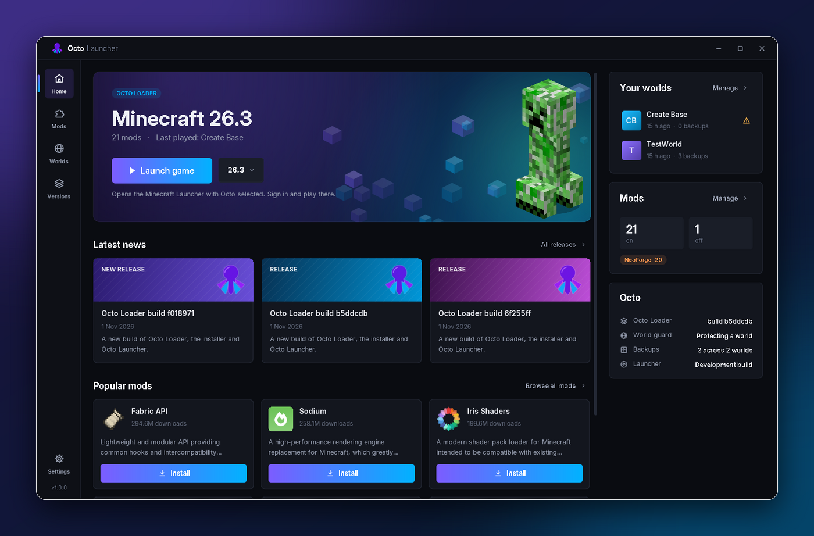
</p>

**The easiest way to play with Octo.** Sign in with your Microsoft account, and Octo Launcher downloads Minecraft and starts it, with your mods and [Octo Client](#octo-client). Change your skin and cape in a click. Find mods on Modrinth and install them in one click, with everything they need. Turn mods on and off, keep them up to date, and back up or restore any world. Then press **Launch game**.

| Windows | Any system with Java 17+ |
|---|---|
| Download **[`OctoLauncher-Setup.exe`](https://github.com/MilkdromedaStudios/Octo-Loader/releases/latest)** and run it. No admin prompt, Java included, Start menu and desktop shortcuts. | Download **[`octo-launcher.jar`](https://github.com/MilkdromedaStudios/Octo-Loader/releases/latest)** and double-click it. |

<p align="center">
  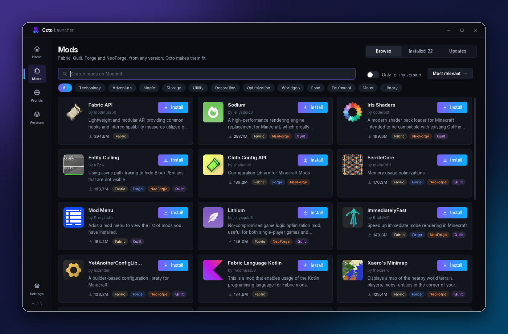
  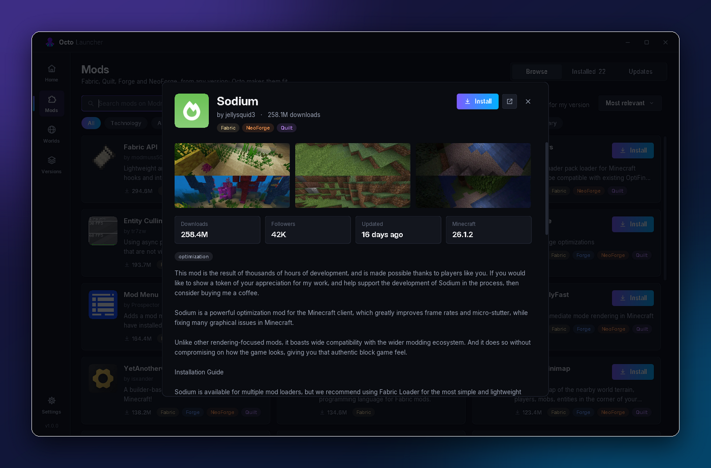
  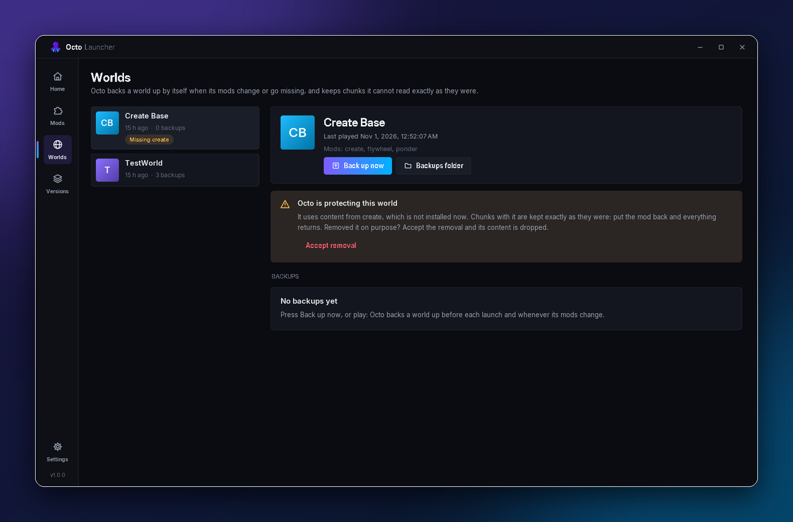
</p>

<p align="center">
  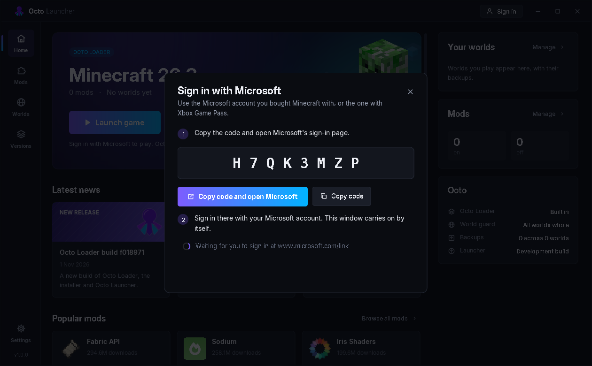
  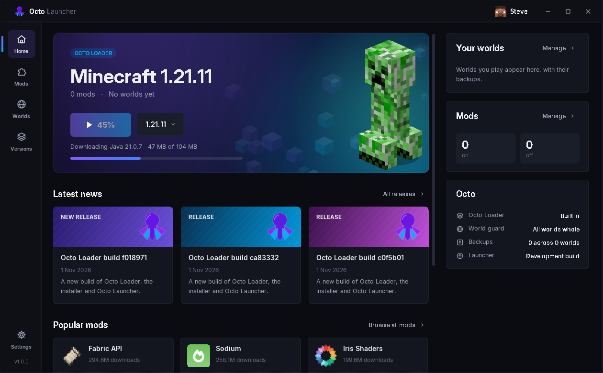
  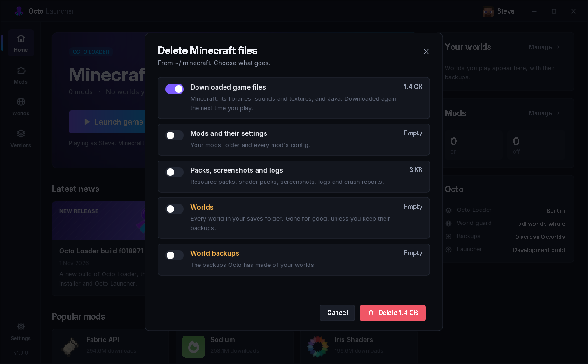
</p>

<p align="center">
  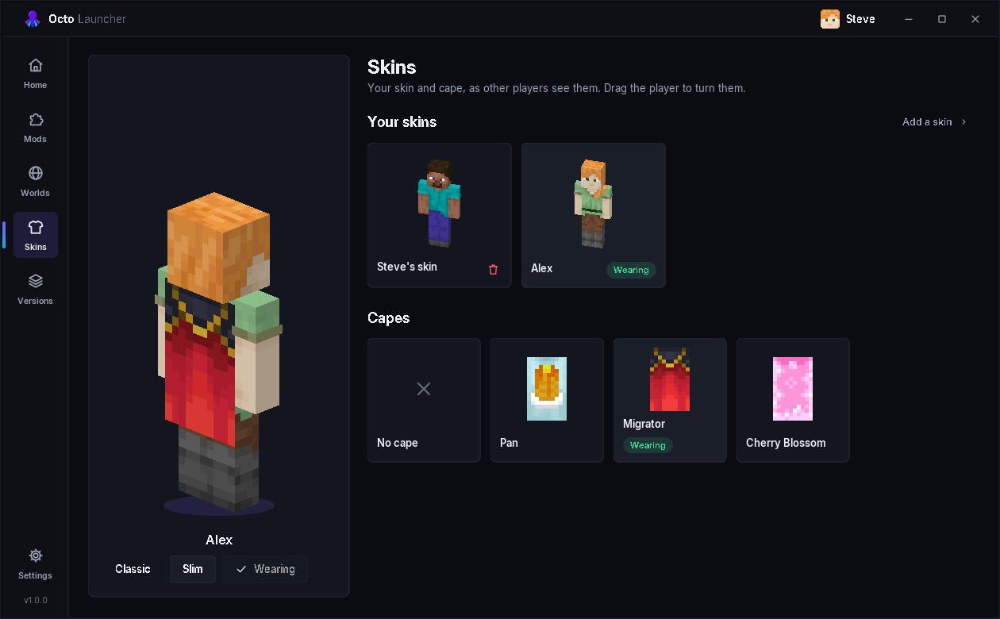
</p>

<p align="center"><sub>Mods · a mod's page · worlds · signing in · launching · deleting files · skins and capes. More about it in <a href="#octo-launcher">Octo Launcher</a> below.</sub></p>

### Octo Client

**Octo Launcher plays with its own client mod.** Octo Client changes how Minecraft looks and adds what players expect from a client, all set in one menu: press **Right Shift**, or **Octo Client** on the title or pause screen.

<p align="center">
  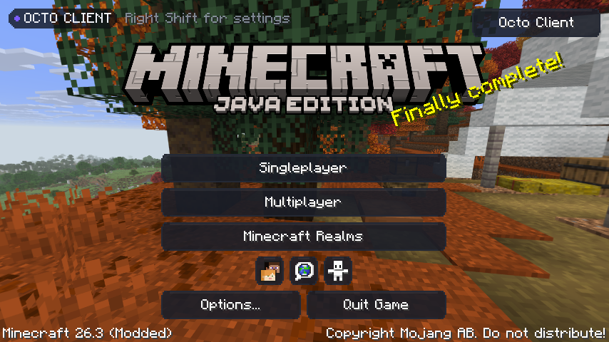
  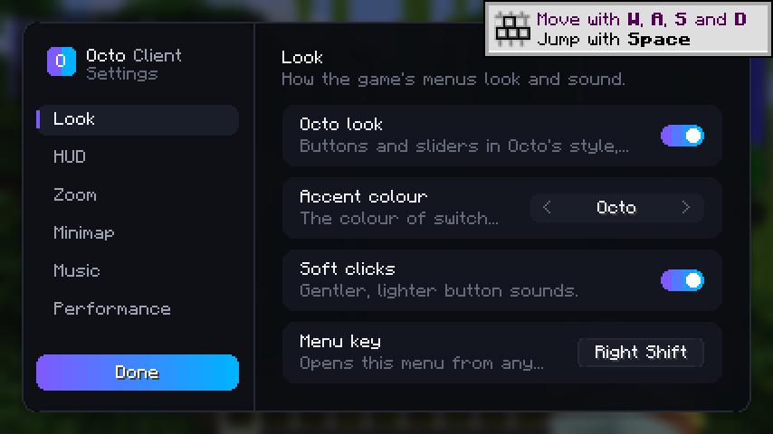
  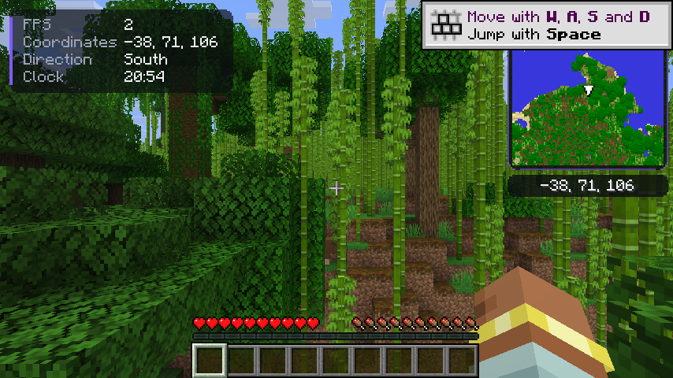
  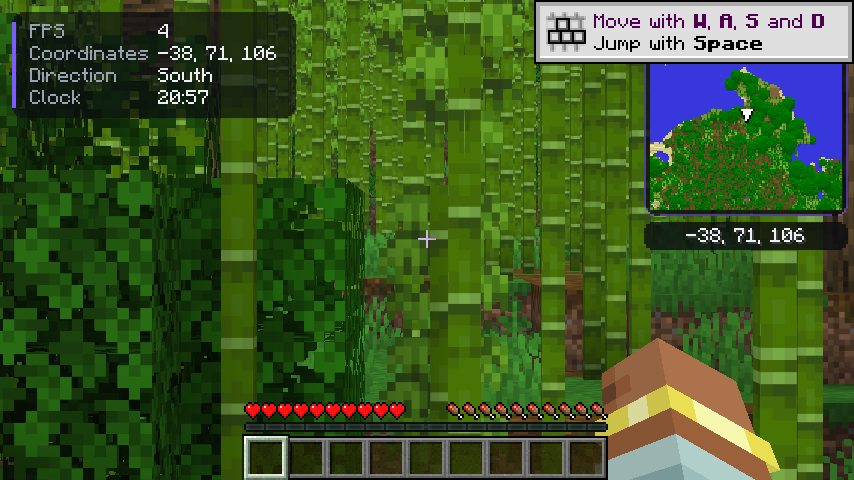
  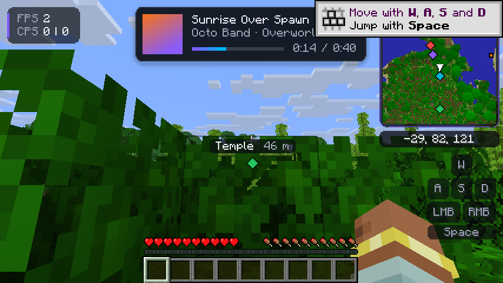
  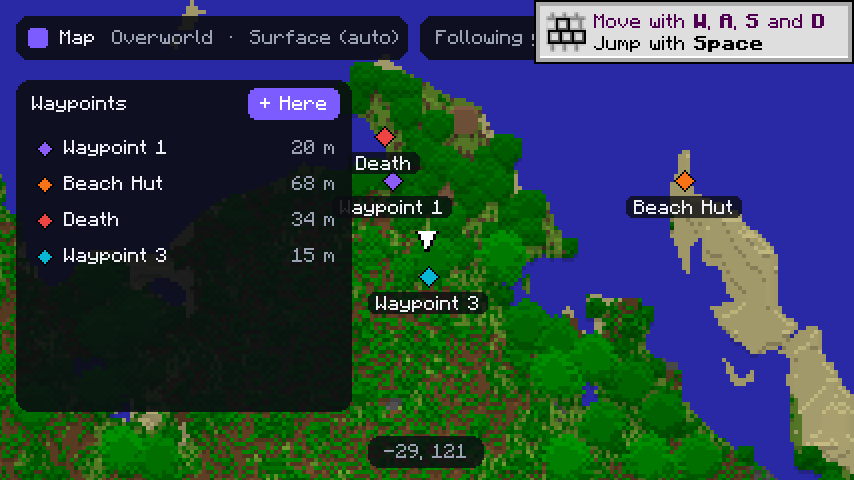
</p>

| | |
|---|---|
| **A modern look** | Every button and slider in the game is redrawn in Octo's style: dark, rounded, lit with your accent colour when you point at it. It's drawn with the game's own flat fills, so it costs no more than the textures it replaces. Five accent colours, and softer button clicks. |
| **The Octo menu** | A settings screen, not a hack-client board of panels: categories down the side, a switch, choice or slider for each setting, saved as you change it. |
| **Zoom** | Hold **C** to zoom (2× to 12×), eased in and out. While zooming, the mouse wheel goes further in or out. |
| **HUD loadouts** | Pick a loadout: *Minimal*, *Essentials*, *PvP* (CPS, ping, armour, keystrokes), *Builder*, *Explorer*, or *Custom* with your own modules (FPS, coordinates, direction, biome, clock, speed, ping, CPS, memory, armour, keystrokes). |
| **Minimap** | North-up, coloured like Minecraft's maps, any size from 64 to 256 pixels and three ranges. **Smart altitude:** underground it switches to the cave you are in, showing the floor around your level, walls in shadow and drops darker the deeper they go; on the surface, the ground is shaded by its height against yours, so mountains stand out and valleys sink. It works in the Nether too, and redraws a few rows each tick, so it never costs a frame. |
| **Waypoints** | Press **B** to set one where you stand. Each shows on the minimap (at its edge when it's further away), over its spot in the world with how far it is, and on the big map. A waypoint marks where you last died. They're kept for each world and server. |
| **Big map** | Press **M** for the minimap full screen: everywhere you've been this session, your waypoints, and you. Drag to move, scroll to zoom, right-click to set a waypoint there. Rename, recolour, hide or delete waypoints in its side panel. |
| **Your music** | Put music files in `.minecraft/octo/music` and turn on **Your music**: they play instead of Minecraft's music, through the game's own sound device. **MP3, Ogg Vorbis, FLAC, WAV and AIFF** all play. Shuffle, or play in order by file name. |
| **Now playing** | A card with the song's cover, title, artist and album, and how far through it is, when a song starts or all the time. The cover comes from the file's own tags, or from a `cover.jpg` or `cover.png` (or a picture named like the song) beside it. |
| **Sizes** | Resize it all: **HUD size** scales Octo's HUD, from the info panel to the minimap, keys and card (50–200%), and the minimap and the now-playing card have sizes of their own. The card keeps clear of the hotbar and the minimap whatever their sizes. |
| **Frame-rate savers** | A lower frame rate while another window is in front. An entity distance, so far-off mobs and items aren't drawn (players can stay visible). Fewer particles in busy scenes. |

Octo Client is built for Minecraft **26.3**. Octo Launcher carries it and loads it when you play 26.3 with Octo, from its own folder, never your `mods` folder. Turn it off under **Settings → Octo Client**. Its settings are in `.minecraft/config/octo-client.json`.

## Octo Launcher

**Windows:** download `OctoLauncher-Setup.exe` from the [latest release](https://github.com/MilkdromedaStudios/Octo-Loader/releases/latest) and run it. It installs for you alone, with no administrator prompt. It brings its own Java and adds a Start menu entry and a desktop shortcut.

**Or the jar:** download `octo-launcher.jar` and double-click it (Java 17 or newer).

| Page | What it does |
|---|---|
| **Home** | Press **Launch game**. Octo downloads the version you picked if it isn't yet, installs or refreshes itself for it, backs up the world you played last, and starts Minecraft, signed in as you. A bar shows how the download is going; the button says **Playing** while the game runs, and if the game crashes, Octo says so and where its output is. The creeper in the banner is drawn in 3D from the texture in your own Minecraft (Octo ships no Mojang assets). Below that: the latest Octo releases, popular mods you can install in one click, your worlds, your mods, and Octo's status. |
| **Mods** | The mod manager. Click any mod for its page: screenshots, downloads, followers, the full description and links. **Browse** searches Modrinth: Fabric, Quilt, Forge and NeoForge mods, by category and sort order, for any Minecraft version (Octo rebuilds mods made for another one). **Install** downloads the mod and every mod it requires, each checked against Modrinth's SHA-512. **Installed** lists what's in your mods folder, with each mod's own icon and version, a switch to turn it on or off, and a remove button. **Updates** finds newer versions of everything, including mods you installed by hand, and updates one or all. |
| **Skins** | You as other players see you, in 3D: drag to turn yourself round. Keep a library of skins (from a PNG, or from any player's name) and wear one in a click, with classic or slim arms. Your capes, Pan, Migrator, Cherry Blossom and whichever others your account has, are listed with their real art: pick one to wear, or none. Changes go to your Minecraft account through Minecraft's own profile service. |
| **Worlds** | Every world with its backups. **Back up now**, **Restore** any backup (the world as it is now is backed up first), and see what the world guard is protecting. **Accept removal** drops content from a mod you took out on purpose. |
| **Versions** | Every version Mojang lists. **Download** any of them, with Octo, or delete one you no longer play (your worlds and mods stay). |
| **Settings** | Your account; memory for the game, its Java and Java options; **Repair** (checks every file against Mojang's checksums) and **Delete files**; your Minecraft folder; automatic updates; backups before each launch, and how many to keep. |

**Signing in.** Press **Sign in** in the title bar. Octo shows a code: enter it on Microsoft's own page ([microsoft.com/link](https://www.microsoft.com/link)) and sign in there, so your password only ever goes to Microsoft. Octo then signs in to Xbox Live and Minecraft the way Minecraft itself does, and checks the account owns Minecraft: Java Edition (Xbox Game Pass counts). The sign-in is kept in `~/.octo-launcher/accounts.json`, readable by your user alone, and renewed by itself, so you sign in once. Sign in more than one account and switch between them in the title bar; **Sign out** removes an account and its sign-in from your computer.

**Playing.** Octo downloads Minecraft from Mojang the way the official launcher does, into the same Minecraft folder: the game, its libraries, its sounds and textures, and the Java that Mojang builds for that version. Every file is checked against Mojang's SHA-1, and nothing already there is downloaded twice. Minecraft 1.12.2 and older start without mods, on their own Java 8, because Octo Loader needs 1.13 or newer. Prefer the official launcher? Turn on **Play through the Minecraft Launcher** in Settings, and Launch opens it with Octo selected instead.

**Deleting files.** **Settings → Delete files** lists what is in your Minecraft folder by kind, with its size: the downloaded game (it downloads again when you next play), mods and their settings, packs, screenshots and logs, worlds, and world backups. Pick what goes. Worlds and backups can't be downloaded again, so deleting them asks you to type DELETE first. Only those folders are touched, never the Minecraft folder itself, and Octo refuses to delete anything in a folder that isn't a Minecraft folder.

<details>
<summary><b>Microsoft sign-in in your own build</b></summary>

Signing in needs a Microsoft (Azure) app registration that Mojang has approved for Minecraft: register an app for personal Microsoft accounts with public client flows allowed, then [ask Mojang for Minecraft API access](https://aka.ms/mce-reviewappid). Step by step, with where to click: **[docs/MICROSOFT-SIGN-IN.md](docs/MICROSOFT-SIGN-IN.md)**. Give the builds its client ID as the repository secret `CLIENT_ID` (or the variable `OCTO_MSA_CLIENT_ID`, or `-PmsaClientId=...` locally), and every build signs players in with it, nothing to set. A build without one asks for an app ID in Settings. A build without one plays through the official Minecraft Launcher.

</details>

**Updates.** When it opens, Octo Launcher checks the latest release. A newer loader is downloaded and installed into every Octo installation. A newer launcher shows **Update** in the title bar, which downloads it and restarts into it, whether it was installed with the Windows installer or run as a jar. Every download is checked against the release's `checksums.txt` (SHA-256) and thrown away if it doesn't match.

<details>
<summary><b>From the terminal</b></summary>

```bash
java -jar octo-launcher.jar sign-in                        # sign in with a Microsoft account
java -jar octo-launcher.jar play 26.3                      # download 26.3 if needed and start it with Octo
java -jar octo-launcher.jar download 26.3 --repair         # check every file of 26.3 and fix what is damaged
java -jar octo-launcher.jar versions                       # versions, and which have Octo
java -jar octo-launcher.jar worlds                         # worlds, backups, and missing content
java -jar octo-launcher.jar backup "My World"              # back a world up now
java -jar octo-launcher.jar restore <backup.zip> "My World"
java -jar octo-launcher.jar update                         # newest loader, installed everywhere
```

</details>

<details>
<summary><b>Building the installer yourself</b></summary>

```bash
./gradlew :launcher:nativePackage                                    # an app folder for this system, with its own Java
./gradlew :launcher:nativePackage -PpackageType=exe                  # Windows installer (on Windows, with WiX 3)
./gradlew :launcher:nativePackage -PpackageType=deb                  # Linux package
./gradlew :launcher:nativePackage -PpackageType=dmg                  # macOS disk image (on macOS)
```

</details>

## Keeping worlds safe

Minecraft saves each block under its mod's name for it. If that mod is missing the next time the world opens (you removed it, it failed to build, it renamed its blocks), the game doesn't know the name, puts **air** there, and saves the air. The blocks, the items in their chests and the mod's mobs are gone for good. Octo's world guard stops that, in the game itself, with or without the launcher:

- **Each world remembers its mods.** `<world>/octo/content.json` lists the mods it was last opened with and every block, item and entity they added.
- **Backups before anything changes.** If content the world uses is missing, the world is backed up before a single chunk is read. It's also backed up when its mods are added, removed or updated (`-Docto.backups.onModChange=false` turns that off). Backups are whole-world zips in `<Minecraft folder>/backups/<world>/`. Octo keeps the newest 10 automatic ones per world (`-Docto.backups.keep=N`) and never removes one you made.
- **Chunks it can't read are kept as they are.** A chunk, or chunk of entities, that holds a block, block entity, entity or item the game doesn't know is never saved over while that content is missing. Put the mod back and everything is there again. Changes you make inside those chunks meanwhile are not kept. `<world>/octo/guard-report.txt` lists what is missing.
- **Removing a mod on purpose?** Accept its removal on Octo Launcher's **Worlds** page (or add its id to `<world>/octo/accepted-removals.txt`). Its content is dropped the next time those chunks save, as it would be without Octo.

`-Docto.worldGuard=false` turns the world guard off.

## Installing mods

1. **Close Minecraft** before you change your mods.
2. **Download** the mod's `.jar`, `.zip` or `.litemod` file from a source you trust. Don't unzip it.
3. **Drop it** straight into `<Minecraft folder>/mods`. A launcher installation with its own game directory uses that directory's `mods` folder instead.
4. **Mix freely.** Fabric, Quilt, Forge, NeoForge, legacy Forge and LiteLoader mods all go in the same folder. Don't install another loader on top of Octo.
5. **Start the Octo Loader installation.** The log names every mod found and loaded.

**Library mods still matter.** If a mod's download page says it needs another mod (Fabric API, Architectury, Cloth Config, Balm, …), install that one too. NeoForge and Forge mods need the loader's own API as well; Octo downloads it for you the first time it is needed.

**Mods from other versions just go in the same folder.** Octo notices that a mod was made for a different Minecraft version and rebuilds it on the first launch, which needs an internet connection once to fetch the name tables for that version. Afterwards the rebuilt copy is cached. You'll see a warning in the log and the report window whenever such a mod is loaded.

**Adding many mods?** Add a few at a time. If something goes wrong, you'll know which mod caused it.

### Tested on Minecraft 26.3

These sets are part of Octo's own test runs on a 26.3 server. Every mod listed starts up and runs. Mods built for an older version are rebuilt for 26.3 as described above.

| Set | Mods |
|---|---|
| **Create and add-ons** (NeoForge 1.21.1) | Create 6.0.10 with Flywheel and Ponder; Steam 'n' Rails, Create Connected, Copycats+, Create Deco, Create Crafts & Additions, Create Enchantment Industry, Create: Dragons Plus, Slice & Dice |
| **Popular NeoForge 1.21.1** | JEI, Jade, AppleSkin, Farmer's Delight, Supplementaries and Moonlight, Sophisticated Backpacks, Waystones and Balm, GeckoLib |
| **NeoForge 26.3** | JEI, AppleSkin, Architectury, Balm, Cloth Config, FerriteCore, Sodium |
| **Forge 26.3** | Collective, GeckoLib, Mouse Tweaks, No Chat Reports, TerraBlender |
| **Fabric** | Fabric API with AppleSkin, Cloth Config and more |
| **Forge 1.12.2** | AppleSkin |

On the 26.3 client, Create's world renders with its moving parts drawn by their own renderers.

"Runs" means the mod loads and its content is in the game. A rebuilt mod can still have features that do nothing on a version it was never written for. The [mod report](#the-game-always-starts) lists exactly what was adapted or skipped.

## Running a server

Put the vanilla `server.jar` in an empty folder, accept Minecraft's EULA, then run:

```bash
java -jar installer.jar server --dir /srv/minecraft
```

The installer creates `start-octo-server.sh` (Linux/macOS) and `start-octo-server.bat` (Windows) plus a `mods` folder. Put server-side mods in that folder and start the server with the script. Players need any mod that its author marks as required on both sides.

## Troubleshooting

<details>
<summary><b>The game started, but a mod is missing or doesn't work</b></summary>

Octo starts the game even when a mod can't load, and opens a report window listing every problem with its cause. The same report is saved to `<Minecraft folder>/.octo/logs/mod-report.txt`. The most common causes are a missing library mod, or a mod that only works on the other side (client vs. server).

</details>

<details>
<summary><b>Where are the logs?</b></summary>

| File | What's in it |
|---|---|
| `.octo/logs/octo-loader.log` | Everything Octo did, including debug detail and anything that happened before Minecraft's own logging started |
| `.octo/logs/mod-report.txt` | Which mods run, which needed changes, and which could not load |
| `logs/latest.log` | Minecraft's own log |
| `crash-reports/` | Minecraft's crash reports |

All paths are inside your Minecraft folder (or the installation's game directory).

</details>

<details>
<summary><b>Minecraft crashes or won't start</b></summary>

1. Read the crash window. It explains what the game was doing and what the error means in plain words.
2. Start once with **no mods** to rule mods out: in the launcher, go to *Installations → Octo Loader → Edit → More options* and add `-Docto.safeMode=true` to the JVM arguments.
3. Remove half your mods and try again to find the one causing the problem.
4. Still stuck? [Open an issue](https://github.com/MilkdromedaStudios/Octo-Loader/issues) and attach `octo-loader.log` and `mod-report.txt`.

</details>

<details>
<summary><b>I have no internet connection</b></summary>

Mods made for your exact Minecraft version need nothing from the network. A mod from another version needs the name tables for its version once, and NeoForge and Forge mods need their loader's API once. Both are cached in `.octo/cache/`. With `-Docto.offline=true`, Octo uses only what is already cached.

</details>

<details>
<summary><b>"pack.mcmeta" errors, or Vulkan / Sodium warnings</b></summary>

A `pack.mcmeta` error comes from an invalid or outdated resource pack in `resourcepacks/`, not from Octo. Messages about missing Vulkan extensions or Sodium workarounds describe your graphics driver: update it, or disable the feature or mod that needs Vulkan.

</details>

## Options

Add these to the launcher's JVM arguments (*Installations → Edit → More options*) or to your server's start script.

| Option | What it does |
|---|---|
| `-Docto.safeMode=true` | Start with no mods at all |
| `-Docto.offline=true` | Never use the network; use only what is cached |
| `-Docto.strict=true` | Stop at the first error instead of starting anyway (for builds and unattended servers) |
| `-Docto.strictVersions=true` | Refuse mods made for another Minecraft version instead of rebuilding them |
| `-Docto.noTranslate=true` | Don't rebuild mods made for other versions |
| `-Docto.noStubs=true` | Don't stand in for classes that no longer exist |
| `-Docto.noReportWindow=true` | Keep the report in the log and file only |
| `-Docto.reportHoldMinutes=<n>` | How long a crash window may keep a finished game open (default 30; `0` never) |
| `-Docto.noApiLibraries=true` | Don't download the NeoForge and Forge API jars |
| `-Docto.mappingsTarget=<version>` | The release whose names rebuilt mods are taken to (default `1.21.11`, the last with intermediary names) |
| `-Docto.noEarlyBootstrap=true` | Leave all of the game's start-up to Minecraft (diagnostics) |
| `-Docto.debug=true` | Verbose logging |

## Command line

The loader jar can also inspect a mods folder without starting the game:

```
$ java -jar octo-loader.jar scan --modsDir mods --mcVersion 26.3

MOD                          VERSION        FORMAT       ERA          PLAN
--------------------------------------------------------------------------------
BuildCraft|Core              6.0.10         Forge (leg.. fml          fml -> modern: apply 95 API rules, stand in for anything still missing
IC2                          2.2.827        Forge (leg.. searge       searge -> modern: apply 95 API rules, stand in for anything still missing
voxelmap                     1.9.28         LiteLoader   searge       searge -> modern: apply 95 API rules, stand in for anything still missing
jei                          15.2.0         Forge        modern       matches this Minecraft - no translation needed
quilted                      2.0.0          Quilt        modern       matches this Minecraft - no translation needed
shiny                        1.4.2          Fabric       modern       matches this Minecraft - no translation needed
```

```
octo launch [options] [-- game arguments]   start Minecraft with every mod in the folder
octo scan   [options]                       report what is there and what would be done
octo version

  --gameDir <path>      game directory (default: current directory)
  --modsDir <path>      mods folder, repeatable
  --gameJar <path>      Minecraft jar, repeatable
  --mcVersion <ver>     Minecraft version, when it cannot be read from the jar
  --side client|server  which side to load for
  --no-translate        do not translate mods built for older versions
  --no-stubs            do not stand in for classes that no longer exist
  --strict              stop on the first mod that cannot be loaded
  --debug               verbose logging
```

From a launcher profile the entry point is `studios.milkdromeda.octo.launch.OctoMain`, which reads the same switches from the `-Docto.*` system properties above, so the launcher's own argument list is left alone.

## How it works

The four loaders each refuse two things: mods from another ecosystem, and mods from another Minecraft version. Octo does neither. The rest of this section explains how, for the curious and for mod authors.

### Supported mod formats

| Format | File | Era |
|---|---|---|
| Fabric | `fabric.mod.json` | 1.14+ |
| Quilt | `quilt.mod.json` | 1.18+ |
| Forge | `META-INF/mods.toml` | 1.13+ |
| NeoForge | `META-INF/neoforge.mods.toml` | 1.20.5+ |
| Forge (legacy) | `mcmod.info` | 1.2.5 – 1.12.2 |
| LiteLoader | `litemod.json` | 1.5.2 – 1.12.2 |
| Bare jar | *(none, recovered from bytecode)* | any |

Jar-in-jar works for both conventions: Fabric/Quilt `jars`, and Forge's `META-INF/jarjar/`. A jar-in-jar payload with no mod metadata goes on the class path as a library rather than being discarded, which is what Create's bundled Registrate needs.

### One runtime, four ecosystems

There is one mod list, one lifecycle and one object share. A Forge mod calling `ModList.get().isLoaded("sodium")` gets a true answer about a Fabric mod. A Fabric mod calling `FabricLoader.getInstance().getObjectShare()` reads values a NeoForge mod published. Mods do not need to know Octo exists.

Almost every current mod changes the game through [Mixin](https://github.com/SpongePowered/Mixin) and an access file. Both are ecosystem-specific in name only, so Octo runs one of each:

- **Mixins.** Fabric's `mixins` array, Quilt's `mixin`, Forge's `[[mixins]]` and the `MixinConfigs` manifest attribute are all read into a single mixin environment, so a Fabric mod and a Forge mod can mix into the same class. MixinExtras is bundled and initialised, as Fabric Loader does.
- **Access.** Fabric's `.accesswidener` and Forge's `accesstransformer.cfg` are parsed into one table and applied as the game loads. A class widened by a Forge mod is open to a Fabric one.

A mod whose mixins cannot be applied loses its mixins and says so. It does not cost every other mod theirs, and it does not stop the game starting. A mixin method that would make its target class fail the JVM's verifier is emptied rather than allowed to take the class down.

### Mods from other versions are rebuilt, not just tolerated

Since 26.1 Minecraft ships without obfuscation, under Mojang's own names, and every mod built for an earlier release speaks a different language from the game: Fabric's intermediary (`class_310`), Forge's SRG (`m_91087_`), or Mojang's names as they stood that year (`ResourceLocation`, which is `Identifier` now). Octo **translates those mods and loads the translation**:

1. **Unzip.** The mod jar is opened. The original in your mods folder is never modified.
2. **Reprogram.** Every class is rewritten into the names this game uses, along with everything that names game classes as text: mixin refmaps, access wideners, access transformers and reflection strings. The tables come from the people who published them (Mojang's deobfuscation maps, Fabric's intermediary and Forge's MCPConfig). Intermediary's numbers never change between versions, so they are the pivot: a 1.21.1 mod's `class_2960` is found in 1.21.11's tables, under today's name. Then the API rules for the eras crossed are applied.
3. **Jar again.** The result is packed into a new jar in `.octo/cache/rebuilt/`, and that jar is what loads.
4. **Cache.** The rebuilt jar is named after a hash of the original and of everything that went into it: Octo's version, the game version, the tables and the rules. Change any of those and it is rebuilt.

What does not survive translation in any form is handled at load time:

- **Missing classes are added back.** A class the game no longer has is restored from the release the mod was built for when it can be, and otherwise generated in exactly the shape the mod uses: its methods, constructors, fields and supertypes. Builder methods hand back the builder, factories hand back a usable object, an event bus field holds a working bus.
- **Missing members are bridged or bypassed.** A method that moved, was renamed, takes wider parameters, became static, or moved to a plural holder class (`RenderType.entitySolid` → `RenderTypes.entitySolid`) is reached the new way. A removed method whose old behaviour is a line or two of the new API is rebuilt from it. Anything else is skipped and a sensible default stands in: an empty list where a list was promised, the receiver for a builder setter, a real value where `null` would crash the next line. Members that other mods add through mixins count as present, so nothing a mod genuinely provides is bypassed.

Everything rebuilt, restored, bridged or bypassed is listed in the log and the mod report.

### Old rendering on the new renderer

26.x rewrote how blocks and block entities are drawn, which leaves every renderer written before it drawing nothing. Octo bridges the old shapes to the new pipeline:

- **Block entity renderers** that still draw through `render(blockEntity, partialTick, poseStack, buffers, light, overlay)` get 26.x's render-state methods. What the old method draws is recorded and replayed through the new renderer.
- **The old block renderer** (`BlockRenderDispatcher`, `ModelBlockRenderer`, `BlockModelShaper`) is added back, with each method answered from 26.x's block models.
- **Models a mod asks for by name** (NeoForge's and Forge's `ModelEvent.RegisterAdditional`, which Flywheel's partial models and many other mods use) are loaded and baked with the game's own models, then handed back through `BakingCompleted.getModels()` and `ModelManager.getModel`.
- **Baked quads** read and built the old way, as 32 ints of vertex data, are translated to and from 26.x's quad records, so mods that reshape or re-texture models keep working.
- **Vertex buffers** a mod builds itself get the vertex layout it was written for, and mixin accessors for render state 26.x removed answer a sensible default instead of crashing the frame.

### What the loaders' patched game did, done again

NeoForge and Forge ship a patched game. Much of what their mods rely on happens in those patches, and Octo runs the unpatched game, so it puts that behaviour back:

- **Game events.** Client, server, level and player ticks, server start and stop, command registration, levels loading and unloading, and players joining and leaving are all fired on NeoForge's game bus. Create's animations, contraptions, trains and commands run on these.
- **Capabilities.** Mods register what their blocks, entities and items offer (inventories, tanks, energy), so pipes, funnels and hoppers can find each other.
- **Networking.** Mods' own packets are written, read and handed to their handlers. Before this, the first packet a mod sent dropped the player from the world.
- **Removed APIs, provided.** NeoForge 26 replaced its item, fluid and energy handlers (`IItemHandler`, `ItemStackHandler`, `IFluidHandler`, `FluidTank`, `IEnergyStorage` and the rest) with a new transfer API. Octo carries working implementations of the old ones, saved in the same format, for the many mods built on them.

### A warning about mods from other versions

A translated mod is running against a game its author never tested. Most of what can go wrong is a feature that quietly does nothing, but some of it can reach your save: a block that saves under one name and loads under another, an entity whose data no longer means what it meant, a world generator writing chunks the game cannot read back. **Back up your worlds, and try such mods in a new world first.**

Octo says so every time such a mod loads: in a banner in the log, at the top of the report window and `mod-report.txt`, and in `octo scan`:

```
WARNING: 3 mod(s) were made for another Minecraft version and would run translated.
         They may misbehave or damage a world. Back up your worlds before playing.
```

<details>
<summary><b>Very old mods: the time capsule</b></summary>

A mod built for 1.7.10 was compiled against classes that no longer exist. What stands between that mod and a modern game is a sequence of mechanical changes, and Octo applies them in order:

1. **Rename.** Mapping tables are composed into a route from the mod's namespace to the running game's (MCP to obfuscated to intermediary to Mojang's names, however many hops it takes) and every reference in the mod is rewritten. `func_71410_x()` becomes `getInstance()`. SRG, TSRG, TSRG2 and Tiny v2 files are all read; drop your own in `<gameDir>/.octo/mappings/` named `<from>-to-<to>.<ext>` and any route through them is found automatically.
2. **Migrate.** Rules cover what renaming cannot express: a method that moved to another class, an instance method that became static, a field that turned into a getter. They ship with the loader and can be extended per instance; see [`loader/src/main/resources/octo/api/README.md`](loader/src/main/resources/octo/api/README.md).
3. **Stand in.** For classes that are simply gone, Octo generates a class of exactly the shape the mod uses. The mod links and runs; calls into the dead API return a default rather than killing the mod at class-load time.

**What this is not.** Mechanical translation cannot invent behaviour. A 1.7.10 mod that registers blocks through a registry that no longer exists will load, run its initialiser, and register nothing. Octo's claim is that the mod runs and that what did not survive is reported, not that a decade-old mod becomes a working modern mod. Mods that only touch API that still exists in some form fare best; deep world-generation and rendering mods fare worst.

</details>

<details>
<summary><b>Mods one version away from the game</b></summary>

The most common problem is small: a current mod on a current game, one version away from the one its author built against. Three things happen, and **none of them happens unless the original has been looked for and genuinely not found**, which is what makes one set of rules correct on every version at once:

1. **A class that survives under another name is redirected to it.** Candidates are listed in [`equivalents.json`](loader/src/main/resources/octo/api/equivalents.json) and tried in order.
2. **A class that is gone outright may be stood in for**, shaped from the mod's own bytecode, so `new ItemStackHandler(9)` gets a class with that constructor.
3. **A mixin aimed at a member that moved is re-aimed**, and one aimed at a member that is genuinely gone is made optional rather than fatal, instead of Mixin's `Critical injection failure` and a dead launch.

Most of the mixin half needs no table, because the answers are in the target class: `lambda$reloadResourcePacks$21` is matched on its stable enclosing method name, an accessor for `entries:Ljava/util/Map;` finds the field by its type when exactly one field has it, and a target whose descriptor drifted is matched on its name when only one method carries it.

</details>

<details>
<summary><b>NeoForge and Forge mods get the real API</b></summary>

Fabric mods depend on Fabric API, which is a mod you install. NeoForge and Forge mods depend on the equivalent half of their loader (`NeoForge.EVENT_BUS`, `ModConfigSpec`, the capability types, every game event), which ships inside the loader. Octo implements the loader half itself (mod list, buses, lifecycle, `@EventBusSubscriber`, configs, Forge 66's `BusGroup` and constructor injection, NeoForge's `FMLLoader`) and, when your mods folder has NeoForge or Forge mods in it, fetches the other half: the project's own `universal` jar for the running game version, from its official Maven repository, cached in `.octo/cache/libraries/`. Those jars expect a game their installer patched. Octo fires the events the patches would have fired where mods depend on them, and bridges the calls they make into patched-in game methods like a translated mod's.

</details>

<details>
<summary><b>Version checks are advisory</b></summary>

Nearly every mod declares a narrow game version, and enforcing it is what makes an old mod "incompatible" even when nothing it calls has changed. Octo treats an unsatisfied *game* version bound as a warning and hands the mod to the translation layer. Bounds *between mods* are still enforced, since those describe APIs the loader cannot fix. `-Docto.strictVersions=true` restores the usual behaviour.

</details>

### The game always starts

If a mod you installed could not be loaded, that is a reason to be told, not a reason to be unable to play. Every failure is collected, written to `.octo/logs/mod-report.txt`, printed to the log, and shown in a window as the game boots:

```
1 mod is not running, and 6 needed adjusting

Not running

  create-1.21.1.jar - its metadata could not be read, so it was not loaded
      fabric.mod.json: malformed JSON: Expected ':' at line 1 column 29

Loaded with changes

  ancientmod - built for Minecraft 1.7.10, translated to run here
```

Everything that could end a launch ends in that report instead: metadata that will not parse, an archive that will not open, dependency resolution rejecting a mod, a mixin that would not apply, a mod that throws while initialising, and every loader API call Octo has not implemented. The window is Octo's own rather than a Minecraft screen, so it works on versions released after Octo. It is not modal and does not hold up the launch.

<details>
<summary><b>And when Minecraft itself crashes</b></summary>

When Minecraft crashes it calls `System.exit(-1)`, which used to take every window with it and leave a launcher dialog saying `Exit code: -1`. Octo takes the exit call itself, a few instructions before the JVM acts on it, so nothing has started shutting down when the crash is shown, and the window stays until you close it. It shows what Minecraft was doing, in its own words; what the failure means in plain language; and what to try next, with the location of Minecraft's own crash report.

A thread dying quietly in the background is recorded but not treated as a crash: mods lose worker threads and the game plays on.

Octo also reads the game's registries back as soon as its start-up claims to have filled them, and names every one that came out empty or without its default entry. That is the real cause behind `Cannot invoke "net.minecraft.core.Holder$Reference.value()" because "this.defaultValue" is null`, which otherwise surfaces seconds later somewhere unrelated.

</details>

<details>
<summary><b>How the four loaders are merged</b></summary>

The upstream sources are vendored as one merged tree in [`upstream/octo`](upstream/octo), laid out by package rather than by project, with provenance in [`upstream/octo/ORIGINS.md`](upstream/octo/ORIGINS.md). The merge happens at the layer that matters: **mods link against concrete classes**, not against "a loader". A Fabric mod imports `net.fabricmc.api.ModInitializer`; a NeoForge mod carries `net.neoforged.fml.common.Mod`. So Octo compiles those upstream sources straight into its own jar and implements the half behind them itself.

| Ecosystem | What is vendored and compiled in | What Octo implements |
|---|---|---|
| Fabric | `net.fabricmc.api.*`, `net.fabricmc.loader.api.*`, the version parser (the whole mod-facing API, verbatim) | `FabricLoaderImpl`, `ModContainer`, `ModMetadata`, `ObjectShare`, `MappingResolver`, the language adapter |
| Quilt | `LanguageAdapterException`, `VersionFormatException` | `QuiltLoader`, `ModContainer`, `ModMetadata`, the QSL entrypoint interfaces |
| NeoForge | `net.neoforged.fml.common.Mod`, `IModBusEvent`, `IExtensionPoint`, `ModConfigEvent`, verbatim | `Dist`, the event bus, the lifecycle events over one `ParallelDispatchEvent`, configs, `ModList`, `LoadingModList`, `ModContainer`, `ModLoadingContext`, `neoforgespi`'s `IModInfo` and `IModFileInfo` |
| Forge | *(reference only)* | `@Mod` covering both the 1.7 and 1.13 shapes, the event bus, both generations of lifecycle event, `ModList`, `LoadingModList`, `ModContainer`, `FMLJavaModLoadingContext`, `forgespi`'s `IModInfo` and `IModFileInfo` |

What is deliberately *not* merged is each loader's bootstrap half: Knot, ModLauncher, SecureJarHandler, Quilt's plugin system. Each expects to own the class loader and the game's entry point, and two of them in one JVM is a contradiction, not a merge conflict. Octo replaces all four with a single transforming class loader that every ecosystem's API sits on top of. That is the only arrangement in which they can share a process, and it is what makes the cross-ecosystem mod list possible.

Because there is a single mod list, `ModList.get().getModContainerById("sodium").get().getModInfo().getVersion()` returns Sodium's real version to a NeoForge mod, out of Sodium's own `fabric.mod.json`.

</details>

## Building from source

You need Git and JDK 17 or newer (CI builds with JDK 21, emitting Java 17 bytecode). The Gradle wrapper downloads the right Gradle for you.

```bash
git clone https://github.com/MilkdromedaStudios/Octo-Loader.git
cd Octo-Loader

./gradlew build                      # compile and run the complete test suite
./gradlew :loader:test               # loader tests only
./gradlew :installer:test            # installer tests only
./gradlew :installer:installerJar    # → installer/build/installer/installer.jar
./gradlew :loader:jar                # → loader/build/libs/octo-loader-1.0.0.jar
```

On Windows, use `gradlew.bat` in place of `./gradlew`. To inspect a mods folder without starting Minecraft:

```bash
java -jar loader/build/libs/octo-loader-1.0.0.jar scan --gameDir /path/to/instance --modsDir /path/to/instance/mods --mcVersion 1.20.1
```

<details>
<summary><b>Contributing, tests and upstream sync</b></summary>

The root project has two Gradle subprojects: `loader` builds the self-contained runtime and command-line scanner; `installer` embeds that loader jar and builds the GUI/client/server installer. Don't edit anything under `upstream/octo` or `build/generated` by hand. Change Octo's own sources, or refresh the merged tree with `python3 scripts/sync-upstreams.py` (needs Python 3, Git and network access).

The vendored loader APIs are checked for updates every day. The [`sync-upstreams` workflow](.github/workflows/sync-upstreams.yml) refreshes the merged tree, records each project's exact commit, runs the complete test suite, and opens a pull request when anything changed.

The tests are not smoke tests. The end-to-end suite compiles six real mods (one per ecosystem, plus a LiteLoader mod and one written against a 2014 API that is never provided again), packs them into real jars, and boots the actual loader against a synthetic game jar. The mixin suite compiles a mod against a widened view of the game, hands the loader the restricted original, and asserts that the mod's `@Inject`, `@Invoker` and access widener all took effect. The transform suites assemble call sites with old descriptors, exactly as a mod from another version arrives, and let the JVM's verifier judge what comes out.

Before submitting a change, run:

```bash
./gradlew build --stacktrace
git diff --check
```

The `build.yml` workflow repeats the build, packages the installer, scans six sample mod formats, and publishes release artifacts from `main`.

</details>

<details>
<summary><b>Project layout</b></summary>

```
loader/                     the loader runtime
  mod/                      the canonical mod model and the six metadata parsers
  discovery/                finding mods, and reading entrypoints out of bytecode
  resolve/                  dependency resolution and load order
  compat/                   eras, mappings, API rules, the version-equivalents table
  transform/                remapping, API migration, class substitution, stand-ins,
                            and the bridges between old and new game APIs
  access/                   access wideners and access transformers, merged
  mixin/                    the mixin service, the one mixin environment, and the
                            version-adaptive target resolver
  bridge/                   per-ecosystem construction and lifecycle, and the
                            client bridges for old renderers and models
  launch/                   the class loader and the launcher
  rebuild/                  unzip, translate, re-jar and cache mods from other versions
  compat/<ecosystem>/       the implementation behind each upstream API
installer/                  installer.jar: client, server, GUI and CLI
upstream/octo/              Fabric, Quilt, Forge and NeoForge sources, merged
                            into one tree by scripts/sync-upstreams.py
docs/                       the logo and other project assets
```

</details>

## Bugs

This is only in development, bugs will be expected and not all mods will be able to be loaded. If you find any bugs, please open a issue or a pr request with fixes if you are tech savy. 

## Licence

Octo Loader's own code is Apache-2.0 (see [`LICENSE`](LICENSE)). The vendored upstream sources keep their own licences: Fabric Loader and Quilt Loader are Apache-2.0, Forge and NeoForge's FancyModLoader are LGPL-2.1. Distributing a binary that combines Apache-2.0 and LGPL-2.1 code is not something to do casually; which files come from where, and at which commit, is in [`THIRD-PARTY-NOTICES.md`](THIRD-PARTY-NOTICES.md). If you plan to redistribute Octo, read that file first.

<p align="center"><sub>Not affiliated with Mojang, Microsoft, FabricMC, QuiltMC, Forge or NeoForged.</sub></p>
